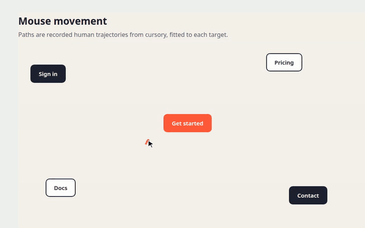
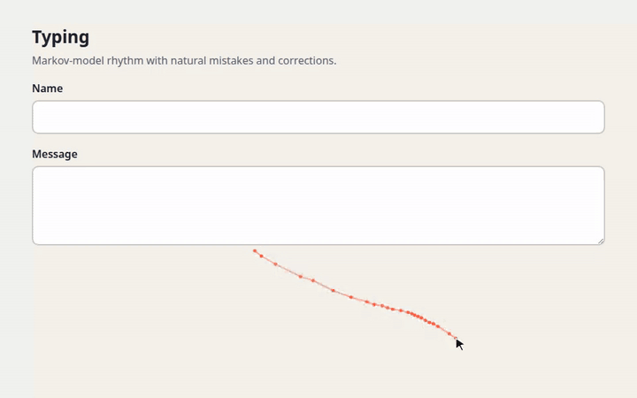
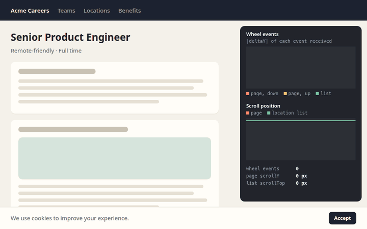

# myuri

Human-like browser **cursor, keyboard, and scroll** simulation — driver-agnostic.

`myuri` moves the mouse along recorded human trajectories (via
[cursory](https://github.com/Vinyzu/cursory)), scrolls with fitted wheel dynamics, and
types with a Markov model that makes natural errors and corrections. It does
**not** talk to a browser itself. You inject a small **Driver** — the functions that
actually move the mouse, press keys, scroll, and read the DOM — so myuri works with
Playwright, Puppeteer, raw CDP, or anything you can wrap.

Available for **TypeScript/JavaScript** (`js/`) and **Python** (`python/`) with a mirrored API.

## See it move

Each dot in the trail is one real `mousemove` event that myuri sent, so dots bunch up
where the hand slows down. The overlays read the browser's own events; nothing is drawn
from the planned path.

| Mouse movement | Typing |
|:---:|:---:|
|  |  |
| Recorded human paths, overshoot and correction | Markov rhythm, typos, backspace fixes |

**Scrolling**



The cursor scrolls to **Apply now** in two flicks and lands it clear of the fixed nav and
cookie bar, then scrolls the nested location list (not the page) to pick Toronto, and
flicks back to the top. The panel charts every wheel event the page received and the
scroll positions of the page and the list. It is drawn onto the frames afterwards from a
timestamped event log, so it doesn't slow the page down; the scroll plays at its real speed.

The GIFs come from [`js/scripts/record-demos.mjs`](js/scripts/record-demos.mjs) with seed
`20260925`: `npm run build && node scripts/record-demos.mjs` in `js/`, or name demos to
record only those (`node scripts/record-demos.mjs scroll`).

```
┌──────────────────────────────┐
│  myuri core (pure, portable) │  scroll model · typing model · seeded RNG
│  + cursory / cursory-js      │  recorded human mouse trajectories
└──────────────┬───────────────┘
               │ Driver interface
   ┌───────────┼───────────┬─────────────┐
 Playwright   CDP     Puppeteer      your custom
 (default)  wrapper    wrapper         driver
```

## Why a Driver?

Older versions hard-coded Playwright/CDP "interaction strategies". myuri instead takes a
single `Driver` object with two groups of capabilities:

- **Input** (required) — `move`, `click`, `down`, `up`, `wheel`, `press`
- **Query** (required) — `evaluate(fn, arg)`
- **Optional** (defaults supplied) — `insertText`, `setClipboard`, `isClosed`, `dispose`

Every DOM measurement myuri needs (element boxes, occlusion, scroll offsets, viewport)
runs through `evaluate`, so any driver that can run JS in the page and dispatch input works.
Convenience wrappers ship for the common cases, so most users inject nothing.

## TypeScript

```ts
import { createCursor } from '@jwriter20/myuri'
import { chromium } from 'playwright'

const page = await (await chromium.launch()).newPage()
await page.goto('https://example.com')

// Playwright driver is inferred from the page object.
const cursor = createCursor(page, { seed: 1234 })

await cursor.move('#username')
await cursor.click('#username')
await cursor.type('hello@example.com')
await cursor.scroll('#footer')
await cursor.click('#word', { clickCount: 2 })   // double click; holdMs for a long press
await cursor.click('#word')                     // again in place: no move; within 500 ms it continues the run
await cursor.drag('#card', '#bin')              // selectors or { x, y } points
await cursor.dispose()          // detaches CDP sessions, clears timers
```

Bring your own driver:

```ts
import { createCursor, defineDriver } from '@jwriter20/myuri'

const cursor = createCursor({
  driver: defineDriver({
    // required input primitives
    move: (x, y) => myBackend.mouseMove(x, y),
    // clickCount 2/3 continue a double/triple click; holdMs is how long to hold the button
    click: (button, clickCount, holdMs) => myBackend.mouseClick(button, clickCount, holdMs),
    down: (k) => myBackend.keyDown(k),
    up: (k) => myBackend.keyUp(k),
    wheel: (dx, dy) => myBackend.wheel(dx, dy),
    press: (key, opts) => myBackend.press(key, opts),
    // required query seam: run a JS function in the page and return its result
    evaluate: (fn, arg) => myBackend.eval(fn, arg),
    // optional (these have defaults built on evaluate/press)
    insertText: (t) => myBackend.type(t),
    setClipboard: (t) => myBackend.clipboard(t),
    isClosed: () => myBackend.closed(),
    // optional, needed only by drag()
    mouseDown: (button) => myBackend.mouseDown(button),
    mouseUp: (button) => myBackend.mouseUp(button),
  }),
})
```

Prebuilt wrappers:

```ts
import { playwrightDriver, cdpDriver, puppeteerDriver } from '@jwriter20/myuri/drivers'
const cursor = createCursor({ driver: cdpDriver(page) })
```

## Python

```python
from myuri import create_cursor
from playwright.async_api import async_playwright

async with async_playwright() as p:
    page = await (await p.chromium.launch()).new_page()
    await page.goto("https://example.com")

    cursor = create_cursor(page, seed=1234)   # PlaywrightDriver inferred
    await cursor.move("#username")
    await cursor.click("#username")
    await cursor.type("hello@example.com")
    await cursor.scroll("#footer")
    await cursor.drag("#card", "#bin")      # selectors or Vector points
    await cursor.dispose()
```

Custom driver: subclass `myuri.Driver` (or pass any object implementing the protocol) and
hand it to `create_cursor(driver=...)`.

## Typing

`cursor.type()` works in two stages:

1. **What gets typed.** A Markov model (from [HumanTyping](https://github.com/Lax3n/HumanTyping))
   adds neighbor-key typos and swapped letters, then notices them and backspaces.
2. **When each key moves.** A timing model plans every keydown and keyup on one timeline.
   It was fitted on recorded human typing (1268 key pairs) and on English bigram
   frequencies from [John Burkardt's NGRAMS dataset](https://people.sc.fsu.edu/~jburkardt/datasets/ngrams/ngrams.html):
   - Common pairs are fast (`th` beats `tk`).
   - Same-finger and row jumps are slow.
   - Word starts, punctuation, digits and noticing a typo all pause.
   - About one key in 17 waits longer, like a person hesitating. These pauses are a little
     rarer and shorter than in the recordings, where they read as stalls.
     `typing.pauses` scales how often (`rate`) and how long (`length`) they are.
   - Shift is pressed and released on its own.
   - About a third of keys overlap the next one (rollover), as in the recordings.
   - `wpm` sets the mean pace (5 characters per word).

The typer sends `down`/`up` itself, and `insertText` for characters no US key produces.
Each action fires at its planned time on an absolute clock, so driver round-trips don't
add to every gap.

**Don't pace keys twice.** If the browser adds its own key timing (for example Camoufox's
humanize keyboard channel), set that to raw while myuri types. Otherwise every gap gets
two delays.

## Scrolling

`settings.scroll.device` picks what the identity scrolls with:

| `device` | What the page sees | Fitted from |
|---|---|---|
| `trackpad` (default) | a stream of small pixel deltas about 8 ms apart, as a flick or a slower drag | recorded 120 Hz trackpad scrolls |
| `mouse` | whole wheel notches, flicked in finger strokes with a re-grip between them | a recorded notched USB mouse on Windows (`notched`) and on macOS (`macos`) |

With `device: 'mouse'`, `scroll.wheel.style` sets how the wheel reports:
- `notched` (Windows, Linux): notches of `pxPerNotch` (default 100). A stroke flicks about
  8 notches (5 to 12) over about 125 ms, fastest at the start, and the finger re-grips for
  about 125 ms, as a recorded mouse scrolled to a target. Notches that land in one 60 Hz
  display frame arrive as one wheel call of 2 or 3 notches, as the page receives them. A scroll of up to 7 notches is nudged instead: a lone
  notch, then strokes of about 2 notches with a re-grip between them.
- `macos`: 20 ms frames of `pxPerLine` (default 16) lines. Each stroke starts at one line a
  frame and accelerates to about 10, as macOS does. After a re-grip of up to 150 ms macOS
  keeps the speed, so the next stroke starts where the last one left off.

A wheel can't move an exact number of pixels, so mouse scrolls land on the nearest whole notch.
The cursor calibrates against the distance it actually sent.

```ts
const cursor = createCursor(page, { settings: { scroll: { device: 'mouse' } } })
```

```python
cursor = create_cursor(page, settings={"scroll": {"device": "mouse"}})
```

**Camoufox:** Camoufox turns every `mouse.wheel` call into notches (100 px is one notch), so
trackpad deltas don't survive it. Use `device: 'mouse'` with the default 100 px notches, and
myuri's strokes reach the page on their timing; a call of several notches arrives as that many
one-notch events. On a macOS identity Camoufox splits each call into lines again, so the
`macos` style (the default with `os: 'macos'`) gets shaped twice there.

## The identity's OS

Pass `os` (`'macos'`, `'windows'` or `'linux'`), the OS the browser claims, so the input
matches it:

- **Shortcut modifier.** Pasting text no US key types (and `selectAllModifier`) uses Cmd on
  macOS and Ctrl elsewhere. Without `os`, the modifier comes from the page's
  `navigator.platform`.
- **Repeated positions.** A move reports its position about every 10 ms on every OS, a
  mouse's report rate; the browser groups the reports into display frames. Only on macOS
  does a report repeat the pixel the pointer is already on. Without `os`, as Windows.
- **Mouse wheel.** With `device: 'mouse'`, macOS defaults to the `macos` wheel style and
  Windows and Linux to `notched`. An explicit `scroll.wheel.style` still wins.
- **Sideways scrolling.** A horizontal wheel scroll holds Shift. On macOS the OS turns the
  events horizontal, so they carry `deltaX`; elsewhere they carry the delta in `deltaY`
  and the browser scrolls sideways.

How long a person takes (to move, click, hold a key, type) is one human model on every OS.
Linux has no recording of its own, so it behaves as Windows apart from the wheel's defaults
above. An unknown `os` throws.

```ts
const cursor = createCursor(page, { os: 'windows', settings: { scroll: { device: 'mouse' } } })
```

```python
cursor = create_cursor(page, os="windows", settings={"scroll": {"device": "mouse"}})
```

## Planning without a browser

The planners return the timelines a `Cursor` plays, with no page or driver. The Cursor
builds its actions from these same functions. Each one takes the random stream as `rng`,
a zero-argument function returning a number in `[0, 1)`; `makeRng(seed)` / `make_rng(seed)`
gives the stream a Cursor uses, and a seed plans the same in both languages. Times are
milliseconds from the start of the plan.

| TypeScript | Python | Returns |
|---|---|---|
| `planMove(start, end, rng, { os, moveSpeed, overshoot, settings })` | `plan_move(start, end, rng, *, os, move_speed, overshoot, settings)` | `{ x, y, t }` points, one a mouse report (about 10 ms); the last is exactly `end`. Off macOS, a Cursor skips a report on the pixel it already sent |
| `planPoint(box, rng, { start })` | `plan_point(box, rng, *, start)` | where in `box` a person clicks; `start` itself when it is already in `box` |
| `planClick(rng, { os, clickCount, sinceReleaseMs })` | `plan_click(rng, *, os, click_count, since_release_ms)` | the dwell before the first press, and each press's down and up. Pass `sinceReleaseMs` when the pointer has not moved since the last release: within 500 ms the click continues that run, as rapid clicks in place do |
| `planType(text, rng, { os, wpm, mistakeMultiplier, pauses })` | `plan_type(text, rng, *, os, wpm, mistake_multiplier, pauses)` | `[t, 'down' \| 'up' \| 'insert', key]` steps, typos included |
| `planPress(key, rng, { os, wpm, pauses })` | `plan_press(key, rng, *, os, wpm, pauses)` | the steps of a key or chord (`'Control+Shift+z'`) |
| `planSelectAll(rng, { os })` | `plan_select_all(rng, *, os)` | Cmd+A or Ctrl+A for `os` |
| `planWheel(dx, dy, rng, { os, device, settings })` | `plan_wheel(dx, dy, rng, *, os, device, settings)` | `['wheel', dx, dy, t]` and `['key', 'Shift', 'down' \| 'up', t]` steps |

Keys are Playwright key names.

```ts
import { makeRng, planMove, planClick } from '@jwriter20/myuri'

const rng = makeRng(1234)
const path = planMove({ x: 10, y: 20 }, { x: 800, y: 450 }, rng)
const click = planClick(rng, { clickCount: 2 })
```

## Smart actions on your own host

`Actions` is what a Cursor runs: the timing and motion of every input, and the decisions
around a click. A click scrolls the element into view with the wheel, picks a point a
person would, checks that a press there reaches the element (nothing covers it), and tries
again after a short wait when it does not, as Playwright retries an action. A miss throws
`Missed` with the reason. The host only sends each event, so the same actions run on a
browser that shapes its own input (Camoufox does) or on anything else that can move a
mouse and run JS in a page.

A host has `move`, `click(button, clickCount, holdMs)`, `down`, `up`, `wheel`, `keyDown`,
`keyUp`, `insertText`, `evaluate(target, fn, arg)` (run a page function on the target's
element), `offset(target)` (the target's window offset from the page, or null when it has
no element), `viewport()`, `now()` (ms) and `sleep(ms)`. A target is whatever the host
resolves: a selector, a Playwright locator. The page functions are `SCROLL_PLAN_JS` and
`HIT_TEST_JS`; the Python package runs the same source as the JS one.

```ts
import { Actions, makeRng } from '@jwriter20/myuri'

const actions = new Actions(host, makeRng(1234), { os: 'windows' })
await actions.click('#submit', { timeout: 10000 })
await actions.type('hello')
```

```python
from myuri import Actions, make_rng

actions = Actions(host, make_rng(1234), os="windows", asynchronous=True)
await actions.run(actions.click("#submit", timeout=10000))
await actions.run(actions.type("hello"))
```

In Python each action is a flow: `actions.run(flow)` runs it, awaiting the host's calls
with `asynchronous=True`, or returning their results on a synchronous host.

### Replacing a part

The actions are built from parts. Pass `parts` to replace any of them; the rest, and every
action that uses the one you replaced, stay myuri's. A replaced scroll is the scroll a
click uses too.

| Part | Does |
|---|---|
| `move(x, y)` | moves the cursor to (x, y) |
| `press(button, clickCount)` | presses where the cursor is |
| `point(box, attempt)` | the point in the element's visible box to press |
| `reaches(target, x, y, pressing)` | why a press at (x, y) would miss the element, or null |
| `intoView(target)` / `into_view` | scrolls the element into view |
| `wheel(dx, dy)` | turns the wheel |
| `type(text)` / `key(key)` | types text, or presses a key or chord |

A part is called with the host, its arguments and a context: `default` runs myuri's part
(with the same arguments when given none), `rng` is the action's random stream, and
`play(steps)` plays a timeline (the `planWheel` / `plan_type` steps above).

```ts
const actions = new Actions(host, makeRng(1234), {
  parts: {
    intoView: async (host, target) => { await myScroll(target) },
    move: (host, x, y, { default: myuris }) => myuris(),
  },
})
```

```python
def into_view(host, target, *, default, rng, play):
    return my_scroll(target)

actions = Actions(host, make_rng(1234), parts={"into_view": into_view}, asynchronous=True)
```

## Settings

Every setting, with its default. Pass any subset as `settings` to `createCursor` /
`create_cursor` or `Actions`; the rest keep their defaults, and a key that doesn't exist
throws. Python spells each key in snake_case (`mouse.speed_factor`).

| Setting | Default | What it does |
|---|---|---|
| `variation` | `0.2` | How far a seed's profile may stray from these settings (±20%). `0` runs them exactly. See [Determinism](#determinism) |
| `mouse.speedFactor` | `1` | Move speed. `2` makes moves take about half as long. A call's `moveSpeed` replaces it |
| `overshoot.threshold` | `500` | Moves longer than this many px overshoot the target |
| `overshoot.radius` | `120` | How far past the target, in px, an overshoot can land |
| `overshoot.correctionSpeedFactor` | `1` | Speed of the correction back, relative to the move |
| `overshoot.dwell.minMs`, `maxMs` | `20`, `60` | The pause before correcting |
| `scroll.speedFactor` | `1` | Scroll speed. `2` halves each scroll and the pause between strokes |
| `scroll.finishPosition` | `0.5` | Where a scroll leaves the element: `0` top, `0.5` middle, `1` bottom of the viewport |
| `scroll.realism.speedIrregularity` | `0.08` | How unevenly a scroll's speed varies |
| `scroll.device` | `'trackpad'` | `'trackpad'` or `'mouse'` (see [Scrolling](#scrolling)) |
| `scroll.wheel.style` | `'notched'` (`'macos'` with `os: 'macos'`) | How a mouse wheel reports: `'notched'` or `'macos'` |
| `scroll.wheel.pxPerNotch`, `pxPerLine` | `100`, `16` | Pixels per wheel notch and per line |
| `typing.wpm` | `80` | Words per minute, counting the default pauses |
| `typing.mistakeMultiplier` | `1` | How often typos happen: `0` never, `2` twice as often |
| `typing.pauses.rate` | `1` | How often a key hesitates: `0` never, `2` twice as often |
| `typing.pauses.length` | `1` | How much time a hesitation adds: `0.5` half |

`typing.wpm` is calibrated with the default pauses, so fewer or shorter pauses type a
little faster than `wpm` (without any, about 12% faster).

```ts
const cursor = createCursor(page, {
  settings: { mouse: { speedFactor: 1.5 }, scroll: { speedFactor: 1.5 }, typing: { wpm: 110, pauses: { rate: 0.5 } } },
})
```

```python
cursor = create_cursor(page, settings={
    "mouse": {"speed_factor": 1.5},
    "scroll": {"speed_factor": 1.5},
    "typing": {"wpm": 110, "pauses": {"rate": 0.5}},
})
```

## Determinism

Both packages use a seeded Mulberry32 PRNG. Pass `seed` to reproduce identical mouse paths,
scroll dynamics, and typing rhythm; read it back with `cursor.get_seed()` / `cursor.getSeed()`.

### Seed → behavioral profile

A cursor runs as one person: it draws each numeric setting from its seed, within
±`variation` of the configured value (normal around it, sd `variation / 2`). The same seed
and settings give the same person every time; another seed is someone similar, not
identical. The device, the wheel and `variation` itself are not drawn. Without a seed the
seed is random, and so is the profile. `Actions` runs the settings it is given as they are.

```ts
import { createCursor, generateProfile } from '@jwriter20/myuri'

const cursor = createCursor(page, { seed: 1234, settings: { typing: { wpm: 100 } } })
cursor.getSettings()                                  // the profile it runs with
generateProfile(1234, { typing: { wpm: 100 } })       // the same profile, standalone
```

```python
from myuri import create_cursor, profile_from_seed

cursor = create_cursor(page, seed=1234, settings={"typing": {"wpm": 100}})
cursor.get_settings()
profile_from_seed(1234, {"typing": {"wpm": 100}})
```

Because both languages share the PRNG and draw order, a seed and settings give an
identical profile in TypeScript and Python.

## Repo layout

| Path | What |
|------|------|
| `js/` | npm package [`@jwriter20/myuri`](https://www.npmjs.com/package/@jwriter20/myuri) |
| `python/` | PyPI package [`myuri`](https://pypi.org/project/myuri/) |
| `docs/media/` | the icon and the demo GIFs used in this README |

## Mouse trajectories: cursory

myuri doesn't generate mouse paths itself. It uses **[cursory](https://github.com/Vinyzu/cursory)**
by [Vinyzu](https://github.com/Vinyzu/). cursory finds the closest match to each movement in a
database of recorded human trajectories, then morphs, jitters, and resamples it onto the
requested endpoints.

| Package | Uses |
|---|---|
| `myuri` (TypeScript) | [`cursory-js`](https://github.com/JWriter20/cursory-js), a TypeScript port of cursory |
| `myuri` (Python) | [`cursory`](https://pypi.org/project/cursory/), the original |

cursory-js reproduces cursory's numpy random stream bit for bit. myuri gives both libraries
a seed drawn from its own seeded stream, so a given myuri `seed` produces the same mouse path
in TypeScript and Python (to within about 1e-12 px of floating-point rounding).

## Thanks to

- [Vinyzu](https://github.com/Vinyzu/), for [cursory](https://github.com/Vinyzu/cursory), which
  every mouse movement in myuri comes from.
- [Pointergeist](https://github.com/Pointergeist), for helping Vinyzu understand mouse
  trajectories better.
- [Margit Antal, Norbert Fejer and Krisztian Buza](https://github.com/margitantal68), for
  [SapiMouse](https://ieeexplore.ieee.org/document/9465583), and
  [MIMIC-LOGICS](https://github.com/MIMIC-LOGICS/), for
  [Mouse-Synthesizer](https://github.com/MIMIC-LOGICS/Mouse-Synthesizer): the recordings
  behind cursory's trajectory database.
- [John Burkardt](https://people.sc.fsu.edu/~jburkardt/), for the
  [NGRAMS](https://people.sc.fsu.edu/~jburkardt/datasets/ngrams/ngrams.html) English letter
  frequencies behind the typing rhythm.

## License

[GNU LGPL v3 or later](LICENSE) © Jake Writer. You can use myuri in commercial and
closed-source projects. If you distribute a modified myuri, its source has to stay
available under the same license.

cursory is © Vinyzu, dual-licensed under LGPLv3-or-later and GPLv3-or-later; cursory-js is
LGPLv3-or-later. myuri depends on them and doesn't redistribute them. The embedded bigram
table is derived from John Burkardt's LGPL NGRAMS dataset. See [`NOTICE`](NOTICE).
